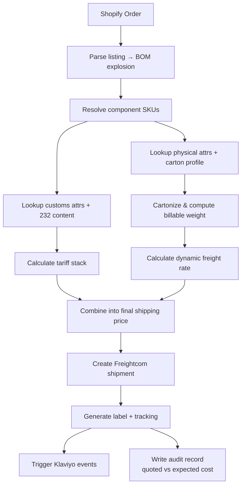
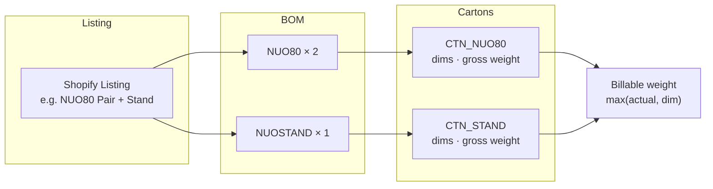
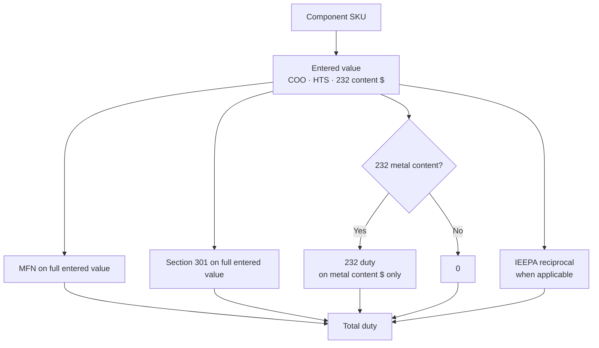
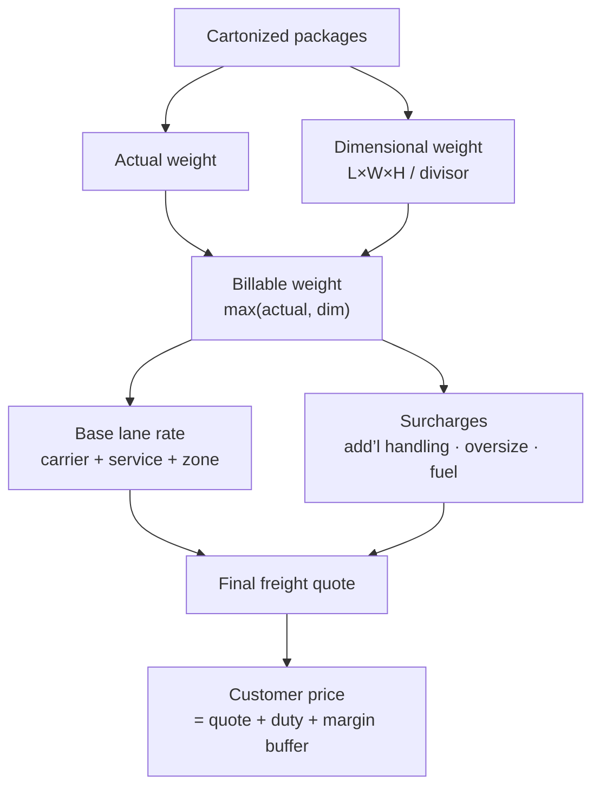

# Revenue Operations & Growth Systems

Production systems for order automation, dynamic rate calculation, multi-layer tariff logic, multi-source reconciliation, and growth instrumentation.

This repository documents and implements the operational data and decision layer built for a direct-to-consumer fitness equipment business. The primary system automates the path from Shopify order to customer-facing shipping price to fulfillment to delivery, incorporating real package characteristics, destination, and full tariff stacks (including Section 232 metal-content duties). Supporting systems provide independent reconciliation across data sources and event-level measurement of the customer journey.

## Core System: Order Automation, Dynamic Shipping & Tariff Engine

The central system replaces manual or static shipping and duty calculations with a deterministic pipeline that:

- Explodes Shopify listings into component-level BOMs
- Looks up physical properties (weights, carton profiles) and customs attributes (HTS, country of origin, metal content value)
- Calculates the correct tariff stack on a per-SKU basis
- Computes dynamic freight rates from billable weight, dimensional weight, lane, and surcharges
- Returns a final shipping price, creates the shipment via Freightcom, and triggers downstream notifications and audit records

### Data Model (selected)

| Table / Source | Grain | Purpose |
|---|---|---|
| `sku_master` | one row per component | Weight, carton profile, HTS, COO, unit cost |
| `listing_bom` | one row per listing × component | Explodes singles, pairs, pair+stand into quantities |
| `material_content_232` | one row per SKU × metal | Aluminum/steel content value used as the **only** base for Section 232 duty |
| `tariff_rules` | one row per tariff line | MFN, Section 301, Section 232, IEEPA reciprocal — rates, bases, refund status |
| `carton_profiles` + rate inputs | carton / parameter | Dimensional weight divisors, surcharge thresholds, observed lane rates |
| Freightcom shipments & charge lines | shipment / charge | Quoted vs billed for variance attribution |

### End-to-End Flow



### SKU → BOM → Cartonization



### Tariff Calculation Path (U.S. orders)



Section 232 is computed exclusively from the metal content value stored in `material_content_232`, never from the full commercial invoice value. This produces an auditable number that can be compared against carrier 7501 lines and supports post-entry corrections when the carrier has charged on the wrong base.

### Dynamic Shipping Rate Logic



The same engine produces both the customer-facing quote and the expected carrier cost, so margin is protected in real time and later variances can be explained.

### Impact

After deployment, the system eliminated manual rate calculation for the majority of orders, reduced fulfillment exceptions caused by incorrect weights or duty estimates, and improved contribution margin on cross-border orders by protecting against under-quoted shipping and over-charged tariffs. Every quote and shipment is written to an audit table that supports the reconciliation layer described below.

---

## Supporting Layer: Multi-Source Reconciliation & Growth Instrumentation

In addition to the order automation engine, the system performs independent reconciliation across Shopify, Klaviyo, and PostHog and instruments the full customer journey.

### Reconciliation (real run example)

`./run.sh reconcile --start 2026-07-05 --end 2026-11-02`

| metric | compared | variance vs source of truth | severity |
| --- | --- | ---: | --- |
| order count | Klaviyo vs Shopify | 0.00% | ok |
| gross revenue | Klaviyo vs Shopify | 0.00% | ok |
| refunds | Klaviyo vs Shopify | 11.08% | critical |
| net revenue | Klaviyo vs Shopify | 2.75% | warn |
| active customers | Klaviyo vs Shopify | 0.00% | ok |
| quiz email captures | PostHog vs Klaviyo | 1.84% | warn |
| quiz store taps | Klaviyo vs PostHog | 37.50% | critical |

Every count and money exception is fully explained by known causes (unexplained: 0). The refund variance, for example, is entirely accounted for by differences in how cancelled vs partially refunded orders are timestamped and valued between the two systems.

### Instrumentation

Event-level tracking covers:

- Paid acquisition funnels (ad → landing → quiz → email capture → store)
- Order and packaging touchpoints
- Lifecycle email automation (Klaviyo) with deliverability controls
- The measurement layer that ties the above together

This produces the metrics used for engagement, drop-off, and iteration.

---

## Repository Layout

- `src/ingest/` — connectors for Shopify, Klaviyo, PostHog
- `src/reconcile/` — variance detection and known-cause attribution
- `src/model/` — SQL models for orders, sends, and funnels
- `config/` — settings and internal email filters
- `data/sample/` — anonymized samples for local runs

## Running

```bash
./run.sh reconcile --start 2026-07-05 --end 2026-11-02
```

See `Makefile` and `run.sh` for additional targets.

## Notes

- Sensitive rate tables, exact cost figures, and customer data are intentionally omitted.
- Tariff and shipping logic is described at the level needed to understand the system; production implementations contain additional edge-case handling and dispute workflows.
- The order automation engine and the reconciliation layer share the same identity-resolution and audit primitives so that a quoted rate, a billed charge, and a customer-facing price can be traced to the same component-level inputs.
