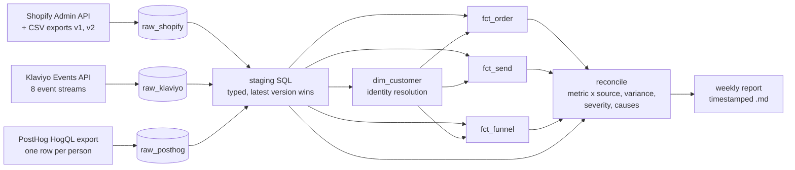

# Rev-Ops

Summit Kabir, third-year Mechatronics Engineering, Ontario Tech. I run the data and operations systems at a DTC fitness company and GTM and Product at a health-tech app, and this is the reconciliation pipeline I built because its numbers lived in three systems that disagreed.

A reconciliation and weekly-reporting pipeline for a direct-to-consumer business whose numbers live in three systems that each tell a different story: Shopify (orders and money), Klaviyo (email, leads and its own copy of every order) and PostHog (quiz behaviour). It exists because reporting from any one of them on its own was wrong in ways nobody could see, and checking by hand took longer than the decision it was meant to support.

Built on real exports from Gym Army, a Canadian fitness-equipment brand, and its LockedIn quiz funnel. Real exports stay on my machine; this repo holds the code, synthetic sample rows with the same schemas, and figures the code printed from the real run.

## The problem

Every system reports its own numbers, and none of them is wrong on its own terms:

- **Shopify** keeps one record per order and changes its state when it is refunded or cancelled.
- **Klaviyo** gets a stream of events from Shopify (Placed Order, Refunded Order, Cancelled Order) and counts money by event date.
- **PostHog** sees anonymous browsers on the quiz and only learns an email when the person submits one.

So "how much did we refund last month" and "how many leads did the quiz produce" had two or three answers, and the only way to choose was to open each tool and reason it out by hand, every week. The job here is to make the definitions explicit, record which system answers which question, and flag the places where they disagree, with the reason.

## Architecture



- **Ingest** (`src/ingest/`): one loader per source, three different grains: an order (Shopify), an event (Klaviyo), a person (PostHog). Every row lands append-only with `source_name`, `stream`, `source_file`, `loaded_at` and a sha256 `row_hash` of the source row, so re-running a load inserts nothing. A source that re-sends a changed row gets a new hash and a new raw row; staging keeps the latest.
- **Schema change**: Shopify's order export changed shape. Version 1 is a 9-column Windows-1252 file with no dates or money; version 2 is a 75-column UTF-8 file with one row per line item and the totals on the first row only. The loader detects the version from the header, never the file name, and stops on a header it does not recognise rather than guess.
- **Model** (`src/model/`, DuckDB SQL): `dim_customer`, `fct_order` (one row per order, source of truth marked), `fct_send` (quiz-flow emails joined to consent state at send time), `fct_funnel` (quiz screens in order, per person).
- **Reconcile** (`src/reconcile/`): computes each metric separately from each source, compares it with the designated source of truth, assigns severity, then runs checks that split the variance into causes.
- **Report** (`src/report/weekly.py`): one fixed weekly layout, run headless.

### Source of truth, by question

| question | source of truth | why |
| --- | --- | --- |
| orders, gross, refunds, net, active customers | Shopify | it holds the order; everything else is a copy of its events |
| quiz email captures | Klaviyo `LockedIn Quiz Completed` | it receives every submission with the email attached |
| quiz store taps, capture-to-tap rate | PostHog | it sees anonymous behaviour Klaviyo never does |

Meta Ads also counts quiz leads, but only for its own optimisation. It is not in the pipeline because there was no connector to pull it. Its published figures appear in the documented cases with their source, never as the answer.

### Identity resolution

A customer is a set of addresses that certainly belong to one person. Two addresses merge only when they are identical after lowercasing and trimming, when Shopify or Klaviyo filed them under one customer or profile id, or when the same Shopify order id appears under one address in Shopify and another in Klaviyo. Anything weaker (plus-addresses, Gmail dots, matching names) is never merged: the pair is written to `identity_review` and both stay separate customers. A doubtful match can therefore overstate active customers but can never hide one, and the report says how many are pending review. Quiz visitors who never gave an email are not customers; they stay in `fct_funnel` without a customer key.

On the real data no pair met a merge rule (`dim_customer merged across addresses: 0`) and 2 pairs went to review. The merge path is exercised by the sample data and the tests.

Internal addresses (my own test runs) are excluded from lead counts in every source. They come from the data, as anyone who ever sent an event flagged `is_test`, plus a list in `config/internal_emails.yml` stored as sha256 hashes so no address is committed.

## Volumes

Pulled on 2026-11-03 for 5 July to 2 November 2026, printed by `./run.sh reconcile`:

| source | stream | raw rows |
| --- | --- | ---: |
| Shopify | orders, Admin API | 168 |
| Shopify | order export v1 (legacy) | 13 |
| Shopify | order export v2 (line items) | 8 |
| Klaviyo | Placed Order / Cancelled Order / Refunded Order | 169 / 37 / 2 |
| Klaviyo | Quiz Completed / Quiz Store Clicked | 195 / 15 |
| Klaviyo | quiz results emails received | 171 |
| Klaviyo | subscribed / unsubscribed to email marketing | 1,300 / 1,095 |
| PostHog | quiz people | 1,754 |

The model built from them: 2,264 customers, 188 orders, 171 sends and 12,451 funnel rows (person x quiz screen).

Carried over from an earlier write-up of mine, where they were measured and not re-measured here: the Klaviyo account held 8,304 profiles with a valid email in August and 8,531 in October, and an earlier check matched 1,461 per-recipient open events against Klaviyo's own per-campaign counts across 13 campaigns, with 0 mismatches.

## The reconciliation, real run

`./run.sh reconcile --start 2026-07-05 --end 2026-11-02`. Money values are left out here on purpose; the variance percentages are what the code printed.

| metric | compared | variance vs source of truth | severity |
| --- | --- | ---: | --- |
| order count | Klaviyo vs Shopify | 0.00% | ok |
| gross revenue | Klaviyo vs Shopify | 0.00% | ok |
| refunds | Klaviyo vs Shopify | 11.08% | critical |
| net revenue | Klaviyo vs Shopify | 2.75% | warn |
| active customers | Klaviyo vs Shopify | 0.00% | ok |
| quiz email captures | PostHog vs Klaviyo | 1.84% | warn |
| quiz store taps | Klaviyo vs PostHog | 37.50% | critical |
| capture-to-store-tap rate | Klaviyo vs PostHog | 34.00% | critical |

Thresholds: any difference in a count is flagged, money is flagged above 1% and critical above 5%. Every count and money exception in this run is fully explained by the checks (unexplained: 0); the rate has no additive split, so its exception lists the same causes without amounts.

## One finding, in full: Klaviyo overstates refunds by 11.08%

**What disagreed.** Over the window, order count and gross revenue matched exactly between Shopify and Klaviyo. Refunds did not: Klaviyo's refunds were 11.08% higher than Shopify's, which made Klaviyo's net revenue 2.75% lower. Anyone reading net revenue off a Klaviyo dashboard would have been reading a number that was too low, with no visible reason.

**How it was found.** Refunds are computed separately from each system for the same window. Shopify: for each order placed in the window, the whole order if it was cancelled, otherwise the amount refunded. Klaviyo: the value of every Refunded Order and Cancelled Order event dated in the window. The reconcile step then runs checks that each count the records showing one known cause and how far those records move the number. On this run the checks account for the whole variance, to the cent:

| cause | records | share of the variance |
| --- | ---: | ---: |
| Orders both cancelled and refunded: Klaviyo receives a Cancelled Order event and a Refunded Order event, each carrying the full order value | 2 | 72.9% |
| A cancellation dated inside the window for an order not placed in it: Klaviyo dates money by event, Shopify by order | 1 | 37.1% |
| Partial refunds on orders that stayed open: none of them produced a Refunded Order event in Klaviyo | 6 | -10.0% |

The first two push Klaviyo up, the third pulls it down, and together they make up exactly 100%.

**The cause.** Klaviyo's refund number is a sum of events, and the events are not one-per-order. When an order is cancelled and refunded, Shopify keeps one record with one state, while Klaviyo receives one event per state change and sums both. In this data the two Refunded Order events Klaviyo holds are both on orders that were also cancelled, and the six partial refunds produced no Refunded Order event at all. A dashboard built on Klaviyo events gets refunds wrong in both directions at once, and in this window the double count was larger.

**What changed.** Shopify is the only source for refunds and net revenue in the weekly report, and `fct_order` carries one reversed amount per order. Klaviyo's order events are still reconciled every week, because a change in that integration should be caught, but its money is never reported. If marketing needs a Klaviyo-side net figure, reversal events have to be collapsed to one per order id, and that still misses partial refunds.

## Documented cases

The reconcile run re-measures each of these from the loaded data (`src/reconcile/known_cases.yml`):

1. **Three lead counts for the first two days of the quiz.** Meta reported 3 leads for 29-30 Sep, but only 2 were real people; the third was my own test run without `?test=1`. PostHog started tracking on the morning of 30 Sep and missed the first real lead. Klaviyo's list held test profiles. Fix: Klaviyo is the source of truth for leads, with internal addresses excluded. On this run, with my 6 internal addresses excluded, exactly 1 Klaviyo lead predates PostHog's first quiz event: the one PostHog missed. Three of those addresses had never sent an `is_test` event, which is why the config list exists.
2. **An unresolved UTM macro.** Some traffic arrived with the literal text `{{ad.name}}` in `utm_content`, so those leads cannot be tied to an ad. On this run: 1 Klaviyo lead and 2 PostHog quiz people carry it.
3. **No link from an order back to the touchpoint.** Of 168 orders in the window, 0 Klaviyo Placed Order events carry any UTM field. The only link between a quiz lead and an order is the email address (3 orders), which says who bought, not what made them buy. Fix: per-channel coupon codes or tagged links on each touchpoint.
4. **Meta's lead count against Klaviyo's.** For the "ADHD Quiz" lead campaign, 29 Sep - 28 Oct, Meta Ads Manager reported 141 Website Leads on $324.19 of spend, $2.29 per lead. Klaviyo holds 136 real leads tagged with that campaign for the same days, so cost per lead on the source of truth is $2.38. One more lead in that window carries an unresolved `{{campaign.name}}`, a second instance of case 2. Meta is not pulled by this pipeline; its figures are carried over from an earlier write-up and printed with their source.
5. **Published quiz funnel figures that PostHog does not reproduce.** An earlier write-up of mine publishes 534 starts, 388 completed results, 313 email captures and 116 store taps for 29 Sep - 29 Oct, labelled PostHog. Counted as people on the production quiz with tests excluded, PostHog holds 402, 150, 146 and 7, and no count of events or sessions reaches the published totals either. The per-ad rows in that write-up do reproduce, as raw event counts. The likely source of the totals is Meta Events Manager, which is not yet confirmed. The published cost per email capture, $1.99, divides $622.68 of spend by 313; on PostHog's 146 it is $4.26. Fix: no funnel figure is published without saying whether it counts events, sessions or people, and which host and test filters apply.

## Weekly report

```bash
./run.sh report --dry-run
```

Loads the folder (idempotent), rebuilds the model, and writes `reports/[sample_]weekly_<week end>_<timestamp>.md`. The report covers the last complete Monday-to-Sunday week (America/Toronto) with each metric's source-of-truth value, the change on the prior week, the exceptions with their most likely cause, and how fresh each source is. `--dry-run` uses `data/sample`; without it the job reads `data/raw`.

Scheduling: `.github/workflows/weekly-report.yml` runs the tests and the dry-run every Monday, which proves the job runs headless on a clean machine. The real report runs locally, where the exports are, from a cron entry:

```bash
0 9 * * 1 cd ~/Rev-Ops && ./run.sh report
```

## Running it

```bash
python -m pip install -e ".[test]"
./run.sh test
./run.sh report --dry-run
./run.sh reconcile --dry-run --start 2026-09-29 --end 2026-11-02
```

`data/sample/make_sample.py` regenerates the synthetic sample. Every row is invented, and each failure pattern above is planted in it so the dry run has something to catch.

Tests cover ingestion idempotency (a second load inserts nothing; a changed row is appended and wins), both export versions and an unknown header, identity edge cases (case and whitespace, two addresses on one order, plus-address lookalikes, anonymous visitors, internal addresses), and that reconcile catches a deliberately introduced variance: a phantom Klaviyo order and a dropped PostHog lead.

## What breaks at 100x

At 100x this is roughly 300,000 Klaviyo events, 175,000 quiz people and 1.2 million funnel rows a pull. In order of what fails first:

1. **Pulling.** Klaviyo's event API returns at most 1,000 events a page, so a full re-pull becomes hundreds of calls. It needs incremental pulls by timestamp cursor, and Klaviyo's bulk export for backfills.
2. **Identity keys churn.** `customer_key` is a hash of the alphabetically first address in a cluster. A new link that brings in an earlier address changes the key for everyone in that cluster, and every downstream table with it. At scale the key has to be assigned once and kept, with merges recorded as a mapping from old key to new.
3. **Identity resolution cost.** The recursive SQL computes every reachable pair, which is fine for thousands of addresses and quadratic inside one large cluster. It would move to an iterative union-find step.
4. **Full rebuilds.** Every run rebuilds staging and facts from all raw rows. It would become incremental on `loaded_at`, with raw partitioned by load date.
5. **Dedup on load.** `append_rows` reads every stored hash into memory. That holds at 100x, but it should become an anti-join (or a `MERGE`) inside the warehouse.
6. **The PostHog export shape.** One row per person with screens packed into a string loses step timestamps and will not scale. Event-level export into the warehouse (PostHog batch exports) is the fix.
7. **One file, one writer.** DuckDB is a single local file. Shared use, access control and scheduled runs belong in a warehouse such as BigQuery.

## What I don't have experience with

**Salesforce administration.** I have never administered a Salesforce org: the standard object model (Lead, Contact, Account, Opportunity), validation rules, Flow, permission sets, sandboxes and deployments. What I would do first is work through the Trailhead Admin Beginner trail in a free Developer Edition org, then rebuild this repo's identity rules there as Salesforce matching and duplicate rules on Lead and Contact, and map `fct_order` onto Opportunity and its line items. That would show me where the model in this repo and Salesforce's own model disagree, which is where a pipeline overhaul breaks.

**BigQuery.** Everything here runs on DuckDB locally; I have not run production SQL on BigQuery. The gaps I know about are partitioning and clustering, cost by bytes scanned, `MERGE` for idempotent loads, scheduled queries and IAM. What I would do first is load `data/sample` into the BigQuery sandbox, port the model SQL (JSON access, the list comprehension in staging and the recursive identity query are the parts that change), replace hash-based dedup with `MERGE`, and check the bytes billed for one full run.

## Redaction

Committed: code, config, synthetic sample rows, and counts or percentages the code printed from the real run. Not committed: real exports, customer emails, names, addresses, order-level data, revenue totals, and Klaviyo list, flow, message and metric ids. `data/raw/`, `warehouse/` and `reports/` are gitignored.
